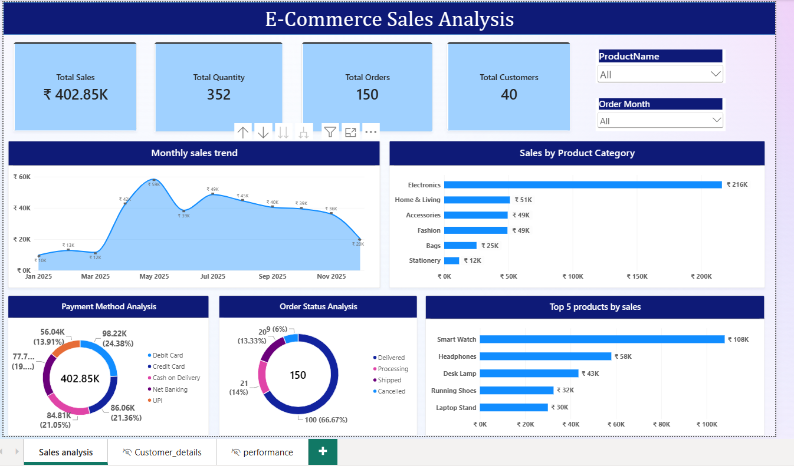

# E-Commerce Sales & Customer Analytics 

##  Project Overview
This project analyzes e-commerce sales, customer behavior, product performance, and order status using Microsoft Power BI. The interactive dashboards help understand sales trends, identify top-performing products, and explore customer segments.

##  Project Objectives
- Analyze total sales, quantity, orders, and customers.
- Track monthly sales trends.
- Compare sales across product categories.
- Analyze payment methods and order statuses.
- Identify top-selling products and customers.
- Explore customer locations and segments.
- Analyze product prices and quantities sold.

##  Tools & Technologies
- **Microsoft Power BI** – Dashboard creation and data visualization
- **Power Query** – Data cleaning and transformation
- **DAX** – Measures and calculations
- **CSV Files** – Data sources

##  Dataset Files
The project uses four CSV files:

| File | Description |
|---|---|
| `orders.csv` | Order details, dates, quantities, sales, and order status |
| `customers.csv` | Customer details, cities, segments, and signup dates |
| `products.csv` | Product names, categories, Product ID, and unit prices |
| `payments.csv` | Payment ID, Payment methods, payment Amounts, Payments dates, and payment status |

##  Dashboard Pages

### 1. Sales Analysis
- Total Sales
- Total Quantity
- Total Orders
- Total Customers
- Monthly Sales Trend
- Sales by Product Category
- Payment Method Analysis
- Order Status Analysis
- Top 5 Products by Sales

### 2. Customer Details
- Total Customers
- Total Sales
- Total Orders
- Customers by City
- Customers by Segment
- Top 5 Customers by Sales
- Sales by Customer Segment

### 3. Product Performance
- Total Products
- Total Sales
- Total Quantity
- Average Order Value
- Quantity by Product Category
- Unit Price by Product
- Product Details Table

## 🔗 Data Modeling
The report connects the four tables using relationships between their relevant keys:

- Customers → Orders
- Products → Orders
- Orders → Payments

These relationships help analyze sales, customer, product, and payment data together.

##  Key Insights
The dashboards can help users:
- Identify high-performing product categories.
- Track changes in monthly sales.
- Compare customer segments.
- Identify top products and customers by sales.
- Understand order status distribution.
- Explore product prices and quantities sold.

##  Project Structure

```text
E-Commerce-Sales-Analytics/
├── E-Commerce-Sales-Analytics.pbix
├── orders.csv
├── customers.csv
├── products.csv
├── payments.csv
├── README.md
└── screenshots/
    ├── sales-analysis.png
    ├── customer-details.png
    └── product-performance.png
** ## Dashboard Screenshots**

1. Sales Analysis Dashboard



2. Customer Analysis Dashboard


3. Product Performance Dashboard


Overall Conclusion

This project uses Power BI to analyze e-commerce sales, customer behavior, and product performance. The interactive dashboards present meaningful insights that help users understand business performance and support data-driven decision-making.

